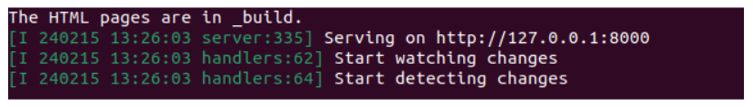

# Get started with Sphinx

If your repository uses Sphinx to create nicely rendered documentation, you will need to set up Sphinx on your machine.
This requires a small chain of steps that are needed to install other things, so you'll need to run through these steps in this order. 

## Install system requirements

Sphinx is a Python based documentation framework. To setup an environment, Sphinx needs:

* Python 3
* `pip`, a Python package manager
* `venv`, a Python package that manages [Python virtual enviornments](https://docs.python.org/3/library/venv.html).

Most projects use `make` as a way to automate and abstract operations. Further steps in this guide assume `make` is installed.

On Ubuntu, ensure all dependencies are installed and your system is up to date:

```bash
sudo apt update
sudo apt upgrade
sudo apt install python3 python3-pip python3-venv make
```

## Make a local build of your documentation

As you're working on your documentation, you'll want to check that your edits are having the desired effect. 

### Navigate to the open-documentation-academy source

If you've been following along on the previous pages, you should be within a folder/directory (possibly called `src`) that contains a sub-directory called `open-documentation-academy`. Let's check where we are first.

Type `ls` on the command line to "list show" all the files and directories you have inside your current directory. If this is a fresh Ubuntu virtual machine, you may not have anything yet, except for the `open-documentation-academy` directory that we created when we cloned the repository.

To move into the `open-documentation-academy` directory use `cd` ("change directory").

```bash
cd open-documentation-academy 
```

This will put you into the `open-documentation-academy` directory that contains the current contents of the git repository from GitHub. 

If you're not sure where you are, you can run `ls` again and navigate. Below is an example if you wanted to contribute to the documentation on this website:

```console
user@machine:~/open-documentation-academy$ ls
adsys  charmcraft  charmed-ceph  landscape  LICENSE  multipass  README.md  snapcraft  ubuntu-desktop  website  wsl
user@machine:~/open-documentation-academy$ cd website
```

## Build the documentation

At this point, you can build the documentation (as it currently exists) on your local machine, with the command `make run`.

`make run` will execute multiple steps, starting with running `install`, and then building.

If `make run` doesn't work initially, then try running this sequence of commands to start with a clean environment:

`make clean` : deletes previously locally built documentation files and Python virtual environments. It's safe to run as it does not delete any of the source changes you may have made.
`make install` : creates a Python virtual environment and install all dependencies. This is the recommended way of dealing installing the Python dependencies.
`make run` : build the documentation and run a local web server hosting the built HTML pages.

If it manages to complete the run successfully, you will see a big rush of commands and output flying past on your terminal window, and eventually, it will stop here:



This means the documentation was successfully built, and now you can view it in your web browser by right-clicking on the <http://127.0.0.1:8000> link and either selecting "open link" or "copy link" (which you can then paste into your browser of choice).

It's really convenient to have this running while you're working on your changes, because every time you save a file, it will update the build and show you a live preview of what your changes look like. 

You can close the running server at any time by pressing `Ctrl` + `C` in the window where it's running.

It's a good idea to open a second Ubuntu tab in your Terminal Window so that you can work in one tab while the documentation can be served in the other. You can do this by clicking on the down arrow next to the currently open tab, and clicking "Ubuntu" (if you're using WSL). 

### On Make commands

Each project may implement different `make` commands. To see available commands run

```bash
make help
```

`clean` is safe to run as it does not delete any changes you've made to the source code. It only deletes the rendered documentation,  so that outdated files are not shown on the next build and a new Python virtual environment with updated dependencies can be created. You can use the `make` commands for more checks depending on the project, such as `make linkcheck` to ensure links are correct and `make spellcheck` for checking spelling on built documentation. An example from the `website` makefile

```console
user@machine:~/open-documentation-academy/website$ make help

 ------------------------------------------------------------- 
 * watch, build and serve the documentation:  make run 
 * only build:                                make html 
 * only serve:                                make serve 
 * clean built doc files:                     make clean-doc 
 * clean full environment:                    make clean 
 * check links:                               make linkcheck 
 * check spelling:                            make spelling 
 * check spelling (without building again):   make spellcheck 
 * check inclusive language:                  make woke 
 * check accessibility:                       make pa11y 
 * check style guide compliance:              make vale 
 * check style guide compliance on target:    make vale TARGET=* 
 * check metrics for documentation:           make allmetrics 
 * other possible targets:                    make <TAB twice> 
 ------------------------------------------------------------- 
```

